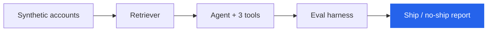

# account-agent-eval

Evaluating a small LLM **account-management agent** the way a release-gating data scientist would — not just "does it work", but *how do we know, how sure are we, and should it ship?*

The agent helps a small B2B supplier manage ~40 restaurant accounts with three tools: **account Q&A**, **reorder flagging**, and **follow-up drafting**. All data is synthetic.



## What gets measured

| Layer | Metrics |
|---|---|
| Retrieval | recall@k, MRR, NDCG |
| Agent | task success (with confidence intervals), groundedness |
| Judge | LLM-judge agreement with human labels |
| Failures | bucketed into retrieval / tool / reasoning |

## Roadmap

| Week | Focus | Output |
|---|---|---|
| 1 | ~20 test tasks (what "good" looks like) + v0 agent with one tool (account Q&A) | `data/` test tasks, v0 agent in `src/` |
| 2 | Retrieval + 2 more tools (reorder flag, follow-up draft); retrieval eval (recall@k, MRR, NDCG); ~40 tasks | v1 agent, `notebooks/` retrieval eval |
| 3 | Eval methods: human labels, LLM-judge calibration, error bars, failure buckets; ship call | `reports/eval-report-v1.md` |
| 4 | Production scoring pipelines (notes) | `docs/scoring-pipeline.md` |

## Layout

```
data/        synthetic accounts & test tasks
src/         agent, tools, eval harness
evals/       eval configs and labeled samples
notebooks/   exploration & metric analysis
reports/     eval reports
docs/        method notes
```

## Setup

```bash
uv sync
cp .env.example .env   # add your Anthropic API key
```
